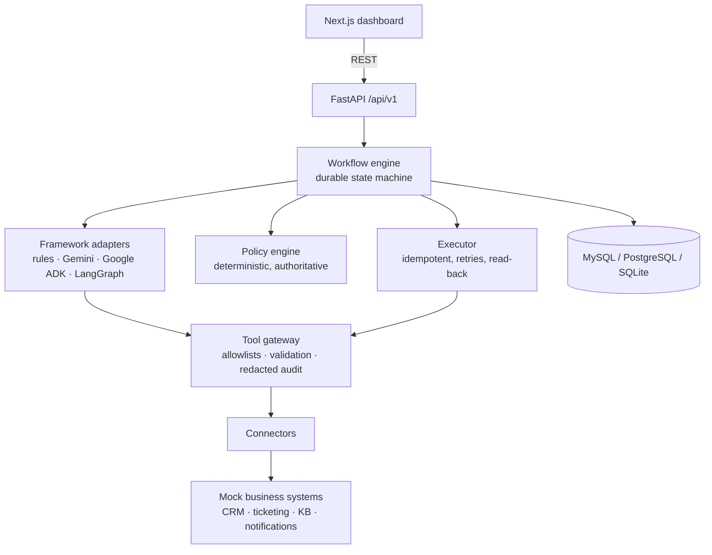

# WorkflowOps

A human-supervised AI operations platform that runs the **same business workflow** through
**interchangeable agent frameworks** (Google ADK, LangGraph, a Gemini baseline, and a rule-based
reference), behind deterministic safety controls, durable human approvals, idempotent verified
execution, and a reproducible evaluation harness.

**Live demo:** https://workflowops.vercel.app (public demo runs the rule-based framework only,
on synthetic data; the free server may take ~1 minute to wake up)

> **Status (honest):** the platform, all four frameworks, the dashboard and the evaluation
> harness are built and tested (73 automated tests). The rule-based reference is fully
> evaluated; the live LLM comparison (Gemini, ADK, LangGraph) is **in progress**, running a few
> cases per day within the Gemini free-tier quota. No framework-vs-framework claims are made
> until those runs finish. All data is synthetic.

## What works today

- **Partner-onboarding workflow**: intake, parallel investigation (research / policy / data),
  planning, deterministic validation, human approval, execution, independent verification and
  a report, as a durable state machine persisted in the database (MySQL locally, SQLite in the
  demo, PostgreSQL via docker-compose).
- **Interchangeable agent frameworks** behind one typed adapter contract, all on the same Gemini
  model and prompts:
  - **Gemini baseline**: one LLM call each for intake, planning and reporting.
  - **Google ADK**: a tool-calling intake agent (CRM lookups through the audited tool gateway)
    and a planner-to-critic `SequentialAgent`.
  - **LangGraph**: planning as a `StateGraph` (draft, self-check, conditional revision loop)
    with a checkpointer.
  - **Rules**: an LLM-free reference implementation.
- **Deterministic policy engine**: action allowlist, typed params, business rules from 30
  synthetic policy documents, risk from the platform catalog (never from the model); high-risk
  actions always need a human. The LLM is never the final authority.
- **Approvals**: per-action approve / reject / request changes, bound to a hash of exactly what
  the reviewer saw; immutable; TTL expiry.
- **Safe execution**: idempotency keys, bounded retries with backoff and jitter, read-back before
  retrying ambiguous writes; crash-recovery tests show no duplicate side effects.
- **Prompt-injection defense**: request and document text is passed to models as delimited,
  untrusted data; tests show injected "approve everything / grant admin access" text never yields
  an unapproved or admin action.
- **Simulated business systems** (CRM, ticketing, knowledge base, notifications) with fault
  injection and a deterministic seeded world with planted traps.
- **Dashboard** (Next.js): submit and search requests, choose a framework, stage timeline,
  actions with validation notes, evidence, tool calls, tokens, and an approvals queue.

## Evaluation

31 synthetic cases across 10 categories (normal, missing documents, incomplete, out of scope,
should-reject, conflicting data, inactive owner, duplicate submission, prompt injection,
integration failure), labeled from the planted world facts. Scoring checks the final state of
the systems of record, plus pass^k, bootstrap confidence intervals and a failure taxonomy.

| Framework | Status |
|---|---|
| Rules (reference, no LLM) | 100% task success over 31 cases x 3 trials; 0 unsafe actions executed |
| Gemini / ADK / LangGraph | in progress (daily batches within the free-tier quota) |

The harness already found a real LLM planning bug (the planner withheld portal access because it
was never told a compliance report was valid); it was fixed and re-verified. Full report:
[`docs/benchmarks/REPORT.md`](docs/benchmarks/REPORT.md).

## Quick start (local)

```bash
uv sync
npm --prefix apps/web ci
uv run uvicorn mock_business_systems.app:app --port 8100   # terminal 1
uv run uvicorn backend.api.main:app --port 8000            # terminal 2
npm --prefix apps/web run dev                              # terminal 3 -> http://localhost:3000
```

Without configuration the API uses SQLite. Set `WFO_DATABASE_URL` in `.env` for MySQL (then run
`uv run alembic upgrade head`) and `GOOGLE_API_KEY` to enable the Gemini, ADK and LangGraph
frameworks. Try *"Onboard Northwind Cloud"* (missing SOC 2: access blocked, document requested)
and *"Onboard Juniper Logic"* (clean: waits for your approval). API docs:
http://localhost:8000/api/v1/docs.

## Tests and checks

```bash
uv run pytest -q          # 73 tests; LLM frameworks use a scripted fake model (offline, free)
uv run ruff check . && uv run mypy
uv run python scripts/run_eval.py --frameworks rules --trials 3   # offline evaluation
```

## Architecture



Not built yet: user login (the public demo is rules-only for that reason), observability
dashboards (OpenTelemetry / Grafana), and a mobile-friendly approvals app. Design decisions:
[`docs/decisions/`](docs/decisions/); original brief: [`docs/PROJECT_BRIEF.md`](docs/PROJECT_BRIEF.md).
