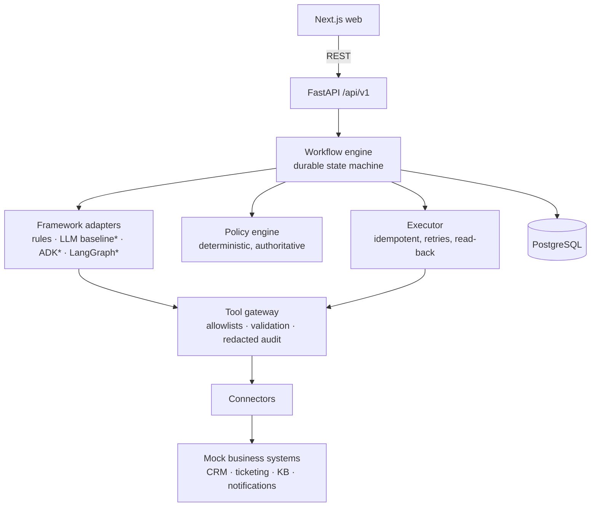

# WorkflowOps

A human-supervised AI operations platform that runs the **same business workflow** through
**interchangeable agent frameworks**, behind deterministic safety controls, durable human
approvals, idempotent verified execution, and (soon) rigorous measurement.

> **Status (honest):** Phases 0–1 are done — the platform runs partner onboarding end to end
> with a **rule-based, LLM-free** agent implementation. LLM baseline, Google ADK, LangGraph,
> observability and the evaluation harness are not built yet. No benchmark numbers exist yet.

## What works today

- **Partner-onboarding workflow** — intake → parallel investigation (research / policy / data)
  → planning → deterministic validation → human approval → execution → independent
  verification → report, as a durable state machine persisted in the database.
- **Deterministic policy engine** — action allowlist, typed params, business rules derived from
  30 synthetic policy documents, risk from the platform catalog (never from the planner);
  high-risk actions always need a human.
- **Approvals** — per-action approve / reject / request changes; bound to a hash of exactly what
  the reviewer saw; immutable; TTL expiry.
- **Safe execution** — idempotency keys, bounded retries with backoff + jitter, read-back
  before retrying ambiguous writes; crash-recovery tests prove no duplicate side effects.
- **Simulated business systems** with fault injection (timeouts, 5xx, malformed JSON, slow
  responses, lost acknowledgements) and a deterministic seeded world with planted traps.
- **Web UI** — submit/search requests, stage timeline, actions with validation notes, evidence,
  tool calls, and an approvals queue.

## Quick start (local, no Docker)

```bash
uv sync
npm --prefix apps/web ci
uv run uvicorn mock_business_systems.app:app --port 8100   # terminal 1
uv run uvicorn backend.api.main:app --port 8000            # terminal 2 (SQLite)
npm --prefix apps/web run dev                              # terminal 3 → http://localhost:3000
```

Try *"Please onboard Northwind Cloud as a cloud partner"* (missing SOC 2: access is blocked,
the doc is requested) and *"Onboard Juniper Logic"* (clean: waits for your approval).
API docs: http://localhost:8000/api/v1/docs.

With Docker: `cp .env.example .env && docker compose up --build` (Postgres; not yet verified
on the author's machine — see `docs/plans/phase-0.md`).

## Tests and checks

```bash
uv run pytest -q          # unit + integration (API and mock systems in-process)
uv run ruff check . && uv run mypy
```

## Architecture


`*` planned. Details: `CLAUDE.md`, `docs/decisions/`, `docs/plans/`, `docs/PROJECT_BRIEF.md`.
